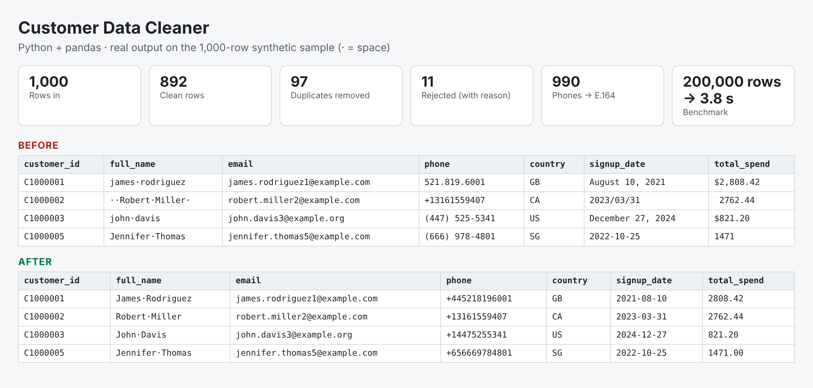

# Customer Data Cleaner (Python + pandas)

Turns a messy CRM / spreadsheet export into a clean, de-duplicated file you can
import anywhere - and tells you exactly what was changed and why.

**200,000 rows cleaned in under 4 seconds** on a laptop-class machine.



## What it fixes

| Problem in the raw file | What the cleaner does |
|---|---|
| `  JAMES rodriguez ` | Trims spaces, fixes casing -> `James Rodriguez` |
| `(415) 555-0132`, `0044 20 7946 0958`, `0812 3456 7890` | Converts every phone to international E.164 (`+14155550132`) using the row's country |
| `USA`, `United States`, `U.S.` | One ISO country code (`US`) |
| `05/03/2024`, `March 05, 2024`, `03-05-2024` | One date format (`2024-03-05`); impossible dates (`31/02/2021`) are flagged, not guessed |
| `$1,234.50`, `USD 99` | Numeric amount (`1234.50`) |
| `jane at example.com`, `jane@example,com` | Safe auto-fix; anything still invalid is blanked and flagged |
| Same person entered twice with different formatting | Kept once; the removed row and the id it was merged into go to `duplicates.csv` |
| Rows with no name or no usable contact | Moved to `rejected_rows.csv` with the reason |

Nothing is silently dropped: every row that goes in ends up in exactly one of
the clean / duplicates / rejected files (a test checks this).

## Run it

```bash
pip install pandas openpyxl tabulate
python generate_sample.py --rows 1000          # or use your own CSV / XLSX
python clean.py sample/customers_raw.csv --out output/ --excel
```

Outputs:

* `customers_clean.csv` (+ `.xlsx` with frozen header and filters) - each row carries an `issues` column such as `invalid date` so nothing is hidden
* `duplicates.csv` - every removed duplicate and the id that was kept
* `rejected_rows.csv` - unusable rows with the reason
* `report.md` / `report.json` - summary counts, before/after preview

See [`sample/output/report.md`](sample/output/report.md) for a real run.

## Adapting it to a client's file

All the rules live in [`cleaner/rules.py`](cleaner/rules.py): country aliases,
dialing codes, accepted date formats (including whether `05/03` means 5 March
or May 3), and the e-mail pattern. Column names are mapped in
[`cleaner/pipeline.py`](cleaner/pipeline.py).

## Tests

```bash
pip install pytest
pytest -q
```

All data in this repo is synthetic, generated by `generate_sample.py`.

## License

This code is shown as a portfolio sample. All rights reserved; contact me for licensing. See [LICENSE](../LICENSE).
